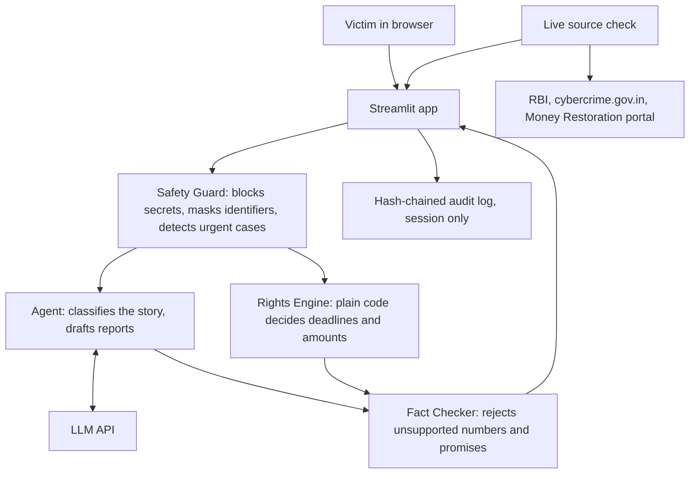

# Wapsi

Cyber-fraud recovery agent for Forge '26, Theme 1, Problem 3. Work in progress: a hosted database is not built yet, and the app stops at the police portal's login (see below).



The LLM classifies and writes. It never decides a deadline, amount or eligibility.

To turn the agent on, set `LLM_BASE_URL`, `LLM_MODEL` and `LLM_API_KEY` as secrets, for any OpenAI-compatible provider.

- `app/decoder.py`: matches a bank's rejection against the 2017 circular and writes an escalation letter.
- `app/agent.py`: classifies the story and drafts reports through an LLM, then fact-checks every number.
- `app/rights.py`: picks the 2017 or 2027 RBI rules by transaction date, then works out deadlines, liability and compensation. Values were read from the RBI 2017 circular and the June 2026 directions for commercial banks.
- `app/safety.py`: blocks OTPs and PINs, masks identifiers, detects urgent cases, and keeps a hash-chained log.
- `app/checks.py`: checks official sources live and confirms each quoted rule clause is still on its source page. Results are cached for 5 minutes.
- `streamlit_app.py`: the web app. `app/main.py` serves the same checks as a FastAPI endpoint, for Docker hosts.

- `docs/PITCH.md`: the problem, audience, USP and comparison, with sources.
- `app/wizard.py`: the guided first screen, one question at a time.
- `app/clocks.py`: the live two-clock first screen, driven by the rules engine.
- `app/extras.py`: fake recovery-agent checker, evidence fingerprints and calendar reminders.
- `SECURITY.md`: what is kept, what leaves the app, threats, controls and what is not built yet.
- `app/portal.py`: prepares a filing kit from the police portal's published notice, including its 200-character minimum and banned characters.
- `app/i18n.py`, `app/labels.py`: page, form and safety messages in Hindi and Telugu. Rule results are in English for now.

Not legal advice. Not reviewed by any bank, regulator or lawyer.

The interface follows public accessibility and service-design principles from India's UX4G design system and GIGW, with this project's own code, text and branding. It deliberately uses no national emblem or government name, and says on every page that it is independent. It is not a UX4G product and has not been audited against either.

## Where the agent stops

The portal asks the complainant to accept a legal declaration, then log in with a mobile OTP and captcha. Wapsi does none of these and never submits. It does not automate the portal: the form sits behind login, so the kit is built from the portal's notice and has not been checked against the form itself.

## Hard-case results

`tests/test_hard_cases.py`, run with no LLM. All 16 pass. All LLM replies in the tests are simulated.

| # | Case | Result |
|---|---|---|
| 1 | Fraud minutes ago | Pass |
| 2 | Still on a digital arrest call | Pass |
| 3 | Shared OTP, before 2027 | Pass |
| 4 | Shared OTP, from 2027 | Pass |
| 5 | Reported to bank only | Pass |
| 6 | Reported to police only | Pass |
| 7 | Reported on day 6 | Pass |
| 8 | Loss of exactly Rs 50,000 and Rs 50,001 | Pass |
| 9 | Compensation already used | Pass |
| 10 | Approved payment, investment scam | Pass |
| 11 | Multiple transactions and banks | Pass: shows the earliest deadline as the safe date |
| 12 | Credit card | Pass |
| 13 | Text says to ignore the rules and promise a refund | Pass |
| 14 | Pasted OTP, in English, Hindi and Telugu | Pass |
| 15 | Message suggesting self-harm, in three languages | Pass |
| 16 | LLM down and portal down | Pass |

## Run locally

```bash
python -m venv .venv
.venv/Scripts/pip install -r requirements.txt -r requirements-dev.txt
.venv/Scripts/python -m pytest
.venv/Scripts/python -m streamlit run streamlit_app.py
```

## Configure

Set `DATABASE_URL` to a hosted Postgres URL. On Hugging Face Spaces, add it as a Space secret. See `.env.example`.
