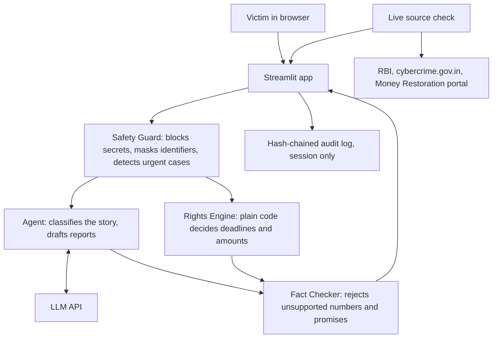

# Wapsi

Cyber-fraud recovery agent for Forge '26, Theme 1, Problem 3. Work in progress: the Portal Agent and hosted database are not built yet.



The LLM classifies and writes. It never decides a deadline, amount or eligibility.

To turn the agent on, set `LLM_BASE_URL`, `LLM_MODEL` and `LLM_API_KEY` as secrets, for any OpenAI-compatible provider.

- `app/decoder.py`: matches a bank's rejection against the 2017 circular and writes an escalation letter.
- `app/agent.py`: classifies the story and drafts reports through an LLM, then fact-checks every number.
- `app/rights.py`: picks the 2017 or 2027 RBI rules by transaction date, then works out deadlines, liability and compensation. The 2017 values were read from the RBI circular. The 2027 values come from news summaries and still need checking against the RBI text.
- `app/safety.py`: blocks OTPs and PINs, masks identifiers, detects urgent cases, and keeps a hash-chained log.
- `app/checks.py`: checks official sources live and confirms each quoted rule clause is still on its source page. Results are cached for 5 minutes.
- `streamlit_app.py`: the web app. `app/main.py` serves the same checks as a FastAPI endpoint, for Docker hosts.

Not legal advice. Not reviewed by any bank, regulator or lawyer.

## Run locally

```bash
python -m venv .venv
.venv/Scripts/pip install -r requirements.txt -r requirements-dev.txt
.venv/Scripts/python -m pytest
.venv/Scripts/python -m streamlit run streamlit_app.py
```

## Configure

Set `DATABASE_URL` to a hosted Postgres URL. On Hugging Face Spaces, add it as a Space secret. See `.env.example`.
